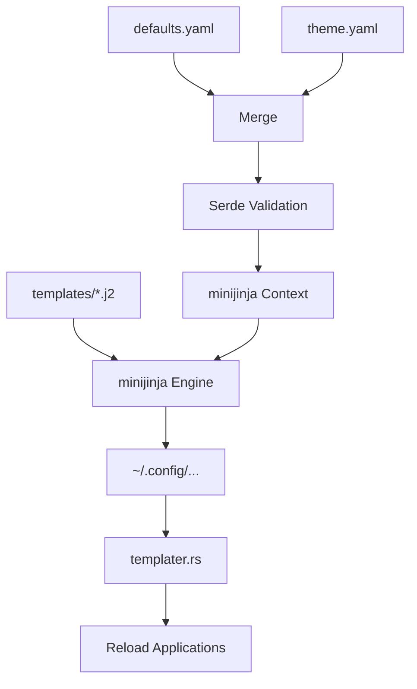

# Architecture Overview

This document provides a high-level overview of the `hypr` configuration system's architecture, designed for developers and contributors.

## Core Philosophy

The project follows a **"Template-Only"** (or Build-Time Generation) architecture. Final configuration files in `~/.config/` are never edited directly. Instead, they are generated from Jinja2 templates using a centralized configuration manager. This ensures:

- **Consistency**: All applications share the same fonts, colors, and layout properties.
- **Portability**: The entire environment can be easily reproduced or updated.
- **Flexible Overrides**: Users can override any setting without breaking the base system.

---

## System Components

### Configuration Manager (`hypr_config_manager`)

The heart of the system is the `hypr_config_manager` Rust crate and compiled binary (`hypr-theme-templater-bin`). It acts as a "compiler" for the desktop environment.

- **Data Sources**:
  **`defaults.yaml`**: Hardcoded system-wide defaults.
  **`theme.yaml`**: Specific settings provided by the active theme. Highest priority.
- **Generation Logic**:
  - Uses **minijinja** to render templates from the `templates/` directory.
  - Handles **Hyprland-specific formatting** via custom Jinja filters (e.g., `hypr_color`, `hypr_border`, `hypr_lua_border`).
  - Implements **Smart Reloading**: Tracks which files were modified and reloads only the affected applications and terminals.
- **Validation**: Uses **Rust struct deserialization** via serde (`models.rs`) and a **JSON Schema** (`theme.schema.json`) to ensure configuration integrity.

### Applications (`hypr_apps`)

A suite of GTK4/Libadwaita Rust applications provides a graphical interface for the configuration manager.

- **Preferences App**: General settings (borders, gaps, fonts, wallpapers).
- **Keybindings Editor**: Interactive management of Hyprland shortcuts with conflict detection.
- **State Management**: The `ThemeStore` singleton (`hypr_config_manager::store::ThemeStore`) manages themes and cached configurations.

### Shell Scripts (`bin/`)

A rich collection of over 100 scripts handles:

- **System Lifecycle**: Updates (`hypr-update`), installation, and "doctor" diagnostics.
- **Hardware Integration**: GPU toggling, backlight control, and specific fixes for laptops (ASUS, Apple, Framework, etc.).
- **UI Interaction**: Menus (`walker` wrappers), OSDs (`swayosd`), and notification management.

### High-Performance Caching Layer

To achieve near-instant UI responsiveness (<10ms refresh times), the system utilizes a three-tier caching architecture:

**Memory Store (`ThemeStore`)**: Caches the parsed and validated `theme.yaml` data. This eliminates redundant disk I/O and validation during complex UI refresh cycles.
**Resource LRU (`GtkManager`)**: Uses LRU caching to store enumerated GTK, Icon, and Cursor themes. This prevents expensive directory traversals during every page reload.
**Config Parser Hot Cache**: Implements a global cache for parsed Hyprland configuration blocks with `mtime`-based invalidation, significantly speeding up recursive setting lookups.

---

## Data Flow



**Merge**: The manager merges data from the YAML sources.
**Validate**: Serde deserialization ensures the merged data matches the expected structure.
**Render**: minijinja renders templates using the validated data.
**Deploy**: The engine writes files to `~/.config/`, but only if they have changed (idempotency).
**Reload**: The reloader in `templater.rs` triggers application-specific commands (e.g., `hyprctl reload`, `hypr-restart-terminal`) to apply changes instantly.

---

## Developer Workflow: Adding a Feature

**Create Template**: Add a new template in `templates/` (e.g., `templates/myapp/config`).
**Add Reload Logic**: If the app needs a special signal to reload, update `hypr_config_manager/src/templater.rs`.

### Hyprland Plugin Architecture

Hyprland plugins (such as `hyprglass`) are integrated using a build-time Jinja2 pipeline and single-source-of-truth configuration:

- **State Management**: Plugin state is defined in `theme.yaml`/`settings.yaml` under `plugins.<plugin_name>`.
- **Compilation**: `templates/hypr/plugins.lua.j2` renders plugin configuration blocks into `~/.config/hypr/plugins.lua`.
- **Runtime Plugin Manager**: `bin/hypr-plugin` manages plugin installation and lifecycle using `hyprpm` under the non-root user context.

## Directory Map

- `bin/`: Executable scripts (mostly Bash).
- `templates/`: Jinja2 source files for configurations.
- `hypr_config_manager/`: Core Rust logic for rendering, parsing, and validation.
- `hypr_apps/`: Rust GTK4/Libadwaita applications.
- `themes/`: Bundled system themes.
- `docs/`: In-depth documentation for specific components.
- `install/`: Scripts and data for the initial installation process.

## Shell Scripting Standards

To maintain safety, reliability, and code quality across all Bash/Zsh scripts in the repository, developers must strictly adhere to the following standards:

**Error Handling & Safety:**
   - All shell scripts must start with `set -euo pipefail`.
   - Explicit error handling must be implemented where commands might safely fail.

**Variable Declarations (SC2155):**
   - **CRITICAL:** When assigning the result of a command substitution (`$(...)`) to a variable, the assignment must happen independently of declaring it `local` or `readonly`.
   - Combining them masks the return value of the command substitution. If the command fails, the declaration itself succeeds (returning `0`), which bypasses `set -e` and causes silent failures.
   - **Incorrect:**
     ```bash
     local var_name=$(command)
     readonly var_name=$(command)
     ```
   - **Correct (`local`):**
     ```bash
     local var_name
     var_name=$(command)
     ```
   - **Correct (`readonly`):**
     ```bash
     var_name=$(command)
     readonly var_name
     ```
