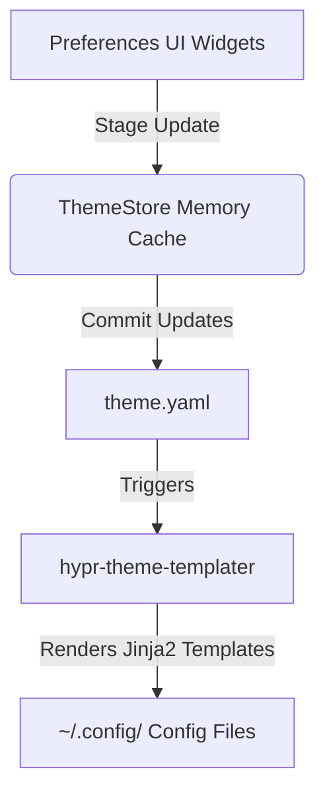

# Preferences Application (`hypr-preferences-app`)

`hypr-preferences-app` is a modern, high-performance configuration GUI built with **Rust**, **GTK4**, and **Libadwaita**. It acts as the central hub for managing the Hyprland environment, including window management, themes, input devices, system states, and application preferences.

---

## Core Architecture

The application adheres strictly to the **Template-Only Generation** design of the environment:



### Key Principles
**Single Source of Truth**: All configurations originate from `theme.yaml`. The app never writes directly to user config directories (e.g. `~/.config/hypr/`). Instead, it commits staging updates back to `theme.yaml`, which triggers the template compiler `hypr-theme-templater` to safely rebuild and hot-reload target config files.
**Tiered Caching & UI Refresh**: UI updates and refreshes are designed to run under **10ms**. Widget updates read settings from the memory-cached `ThemeStore`. Memory caches are invalidated on commit, ensuring the subsequent refresh pulls fresh data from disk.
**Zero-Tolerance Unparenting**: In GTK4/Libadwaita, any dynamic widget insertion (e.g., dynamic rows in display expanders or flowboxes) must explicitly call `.unparent()` or `parent.remove()` on the widget before attaching it to a new parent to prevent `Adwaita-CRITICAL` assertion failures.
**Layout Hardening**: Every widget container enforces horizontal expansion (`hexpand="true"`) and alignment (`halign="fill"`) across layout XML definitions to prevent visual truncation in wide display configurations.
**XML-to-GObject Mapping**: UI components bind directly to corresponding Rust types:
   - `AdwComboRow` -> `"combo"`
   - `AdwSwitchRow` -> `"switch"`
   - `AdwSpinRow` -> `"spin"`
   - `AdwEntryRow` -> `"entry"`
**Markup Escaping**: Special characters passed to markup-enabled controls must be escaped (e.g., `&` as `&amp;`) to avoid layout parser errors.

---

## Settings Pages & Widget Reference

This section details every page, its widgets, their corresponding configuration keys in `theme.yaml`/`defaults.yaml`, and their behaviors.

### Theme Page (`theme.rs` / `theme.ui`)
*Manages themes and global font family overrides.*

| Widget ID | Widget Type | Config Key | Description / Behavior |
| :--- | :--- | :--- | :--- |
| `font_button` | `GtkFontDialogButton` | `fonts.font_family` | Selecting a font stages the family name update. Modifiers like sizes are stripped to maintain font integrity rules. |
| `flowbox` | `GtkFlowBox` | N/A | Dynamic listing of all theme cards. Selecting a card executes `hypr-theme-set <name>` in a thread. |
| `btn_create` | `GtkButton` | N/A | Creates a new theme. |

---

### Appearance Page (`appearance.rs` / `appearance.ui`)
*Manages aesthetic options like borders, gaps, shadows, glow, and animations.*

| Widget ID | Widget Type | Config Key | Description / Behavior |
| :--- | :--- | :--- | :--- |
| `gaps_in` | `AdwSpinRow` | `layout.gaps_in` | Inner window gaps (padding between adjacent windows). |
| `gaps_out` | `AdwSpinRow` | `layout.gaps_out` | Outer window gaps (padding between windows and monitor edge). |
| `border_size` | `AdwSpinRow` | `layout.border_size` | Border width of tiled windows. |
| `rounding` | `AdwSpinRow` | `layout.rounding` | Corner radius for windows, Waybar, Walker, and SwayOSD. |
| `shadow_enabled` | `AdwSwitchRow` | `layout.shadow_enabled` | Toggles drop shadow rendering on windows. |
| `shadow_range` | `AdwSpinRow` | `layout.shadow_range` | Size/range of window shadows. |
| `shadow_power` | `AdwSpinRow` | `layout.shadow_power` | Falloff power (density) of shadows. |
| `shadow_offset` | `GtkEntry` | `layout.shadow_offset` | 2D offset values (format: `"X Y"`). |
| `glow_enabled` | `AdwSwitchRow` | `layout.glow_enabled` | Toggles glow around active window borders. |
| `glow_range` | `AdwSpinRow` | `layout.glow_range` | Range/size of active border glow. |
| `dim_inactive` | `AdwSwitchRow` | `layout.dim_inactive` | Toggles dimming of focused-out windows. |
| `dim_strength` | `AdwSpinRow` | `layout.dim_strength` | Dimming ratio (0.0 to 1.0). |
| `blur_enabled` | `AdwSwitchRow` | `layout.blur_enabled` | Toggles background blur behind transparent windows. |
| `blur_size` | `AdwSpinRow` | `layout.blur_size` | Size of background blur kernel. |
| `blur_passes` | `AdwSpinRow` | `layout.blur_passes` | Number of blur iterations (passes). |
| `blur_vibrancy` | `AdwSpinRow` | `layout.blur_vibrancy` | Vibrancy correction factor for blur (0.0 to 1.0). |
| `gdk_scale` | `AdwSpinRow` | `gtk.gdk_scale` | GTK scale override. |
| `gdk_dpi_scale` | `AdwSpinRow` | `gtk.gdk_dpi_scale` | GTK text scaling. |
| `qt_scale_factor` | `AdwSpinRow` | `gtk.qt_scale_factor` | QT/KDE application scale. |
| `text_scaling_factor` | `AdwSpinRow` | `gtk.text_scaling_factor` | Universal text scaling. |
| `gtk_color_scheme` | `AdwComboRow` | `gtk.color_scheme` | Libadwaita color scheme (e.g. `prefer-dark`, `prefer-light`). |
| `gtk_theme` | `AdwComboRow` | `gtk.theme` | System GTK theme name. |
| `gtk_icon_theme` | `AdwComboRow` | `gtk.icon_theme` | GTK Icon theme name. |
| `gtk_cursor_theme` | `AdwComboRow` | `gtk.cursor_theme` | GTK Cursor theme. |
| `gtk_accent_color` | `AdwComboRow` | `gtk.accent_color` | Libadwaita color accent preference. |
| `cursor_no_hardware` | `AdwSwitchRow` | `cursor.no_hardware` | Disables hardware cursor rendering (useful for virtual machines). |
| `animations_enabled` | `AdwSwitchRow` | `layout.animations_enabled` | Toggle global animations. |
| `animation_style` | `AdwComboRow` | `layout.animation_style` | Select animation speed curves preset (Fluid, Snappy, Classic, Custom). |
| `anim_windows_enabled` | `AdwSwitchRow` | `layout.animation_windows_enabled` | Toggle animations for window creation. |
| `anim_windows_out_enabled` | `AdwSwitchRow` | `layout.animation_windows_out_enabled` | Toggle animations for window destruction. |
| `anim_workspaces_enabled` | `AdwSwitchRow` | `layout.animation_workspaces_enabled` | Toggle workspace transitions. |
| `anim_border_enabled` | `AdwSwitchRow` | `layout.animation_border_enabled` | Toggle animations on border color change. |
| `anim_fade_enabled` | `AdwSwitchRow` | `layout.animation_fade_enabled` | Toggle fade/opacity transitions. |
| `anim_windows_curve` | `GtkEntry` | `layout.animation_windows_curve` | Bezier speed parameters (format: `"x1, y1, x2, y2"`). |
| `anim_windows_speed` | `AdwSpinRow` | `layout.animation_windows_speed` | Speed factor for window transitions. |
| `anim_fade_speed` | `AdwSpinRow` | `layout.animation_fade_speed` | Speed factor for fade transitions. |
| `anim_workspaces_speed` | `AdwSpinRow` | `layout.animation_workspaces_speed` | Speed factor for workspace transitions. |

---

### Layout Page (`layout.rs` / `layout.ui`)
*Manages tiled layout algorithms, groupbar widgets, and workspace behavior.*

| Widget ID | Widget Type | Config Key | Description / Behavior |
| :--- | :--- | :--- | :--- |
| `allow_tearing` | `AdwSwitchRow` | `layout.allow_tearing` | Enables screen tearing (minimizes gaming latency). |
| `layout_name_row` | `AdwComboRow` | `layout.name` | Tiling algorithm selector (`dwindle`, `master`). |
| `single_window_aspect_ratio_row` | `AdwSpinRow` | `layout.single_window_aspect_ratio` | Enforces split rules for wide displays. |
| `single_window_aspect_ratio_tolerance_row` | `AdwSpinRow` | `layout.single_window_aspect_ratio_tolerance` | Split tolerance margin. |
| `ws_layout_1` to `ws_layout_10` | `AdwComboRow` | `layout.workspace_layouts.<index>` | Workspace-specific layout overrides (none, dwindle, master, scrolling). |
| `preserve_split_row` | `AdwSwitchRow` | `layout.dwindle.preserve_split` | Split directions are preserved when windows swap. |
| `smart_split_row` | `AdwSwitchRow` | `layout.dwindle.smart_split` | Splitting decision is based on cursor position. |
| `precise_mouse_move_row` | `AdwSwitchRow` | `layout.precise_mouse_move` | Toggles sub-pixel mouse precision for window resize. |
| `new_status_row` | `AdwComboRow` | `layout.master_new_status` | Master layout focus for new windows (master, slave). |
| `mfact_row` | `AdwSpinRow` | `layout.master_mfact` | Master-to-slave split ratio (0.0 to 1.0). |
| `orientation_row` | `AdwComboRow` | `layout.master_orientation` | Orientation of master area (left, top, right, bottom). |
| `new_on_top_row` | `AdwSwitchRow` | `layout.master_new_on_top` | Pushes new windows to the top of the stack. |
| `new_on_active_row` | `AdwComboRow` | `layout.master_new_on_active` | Split behavior on active window (none, master, slave). |
| `groupbar_enabled_row` | `AdwSwitchRow` | `layout.groupbar_enabled` | Enable rendering groupbars for window tab groups. |
| `groupbar_gradients_row` | `AdwSwitchRow` | `layout.groupbar_gradients` | Enables color gradients in groupbar titles. |
| `groupbar_font_size_row` | `AdwSpinRow` | `layout.groupbar_font_size` | Size of labels in window tabs. |
| `groupbar_height_row` | `AdwSpinRow` | `layout.groupbar_height` | Height of the tab bars. |
| `groupbar_stacked_row` | `AdwSwitchRow` | `layout.groupbar_stacked` | Displays stacked window groups. |
| `groupbar_render_titles_row` | `AdwSwitchRow` | `layout.groupbar_render_titles` | Toggle text labels on tab bars. |
| `groupbar_scrolling_row` | `AdwSwitchRow` | `layout.groupbar_scrolling` | Allows mousewheel scrolling across tabs. |
| `groupbar_text_color_button` | `GtkColorDialogButton` | `layout.groupbar_text_color` | Text color of tab labels. |
| `scrolling_fullscreen_on_one_column_row` | `AdwSwitchRow` | `layout.scrolling_fullscreen_on_one_column` | Maximize behavior for scrolling layout column. |
| `scrolling_column_width_row` | `AdwSpinRow` | `layout.scrolling_column_width` | Default column width ratio in scrolling layout. |
| `scrolling_focus_fit_method_row` | `AdwComboRow` | `layout.scrolling_focus_fit_method` | Center/focus rule (1=Always center, 2=Visibility bound). |
| `scrolling_follow_focus_row` | `AdwSwitchRow` | `layout.scrolling_follow_focus` | Keeps viewport centered on active window. |
| `scrolling_follow_min_visible_row` | `AdwSpinRow` | `layout.scrolling_follow_min_visible` | Minimum visible columns before scrolling. |
| `scrolling_direction_row` | `AdwComboRow` | `layout.scrolling_direction` | Growth orientation for new columns. |

---

### Input Page (`input.rs` / `input.ui`)
*Configures keyboard layouts, cursor speed, touchpad gestures, and Solaar.*

| Widget ID | Widget Type | Config Key | Description / Behavior |
| :--- | :--- | :--- | :--- |
| `sensitivity` | `AdwSpinRow` | `input.sensitivity` | Mouse cursor speed multiplier. |
| `scroll_factor` | `AdwSpinRow` | `input.scroll_factor` | System-wide scroll speed factor. |
| `accel_profile` | `AdwComboRow` | `input.accel_profile` | Acceleration curve (flat, adaptive, none). |
| `follow_mouse` | `AdwComboRow` | `input.follow_mouse` | Focus-follows-mouse behavior (0=Click focus, 1=Hover focus, 2=Detached). |
| `touchpad_enabled` | `AdwSwitchRow` | `input.touchpad_enabled` | Toggle laptop touchpad. |
| `natural_scroll` | `AdwSwitchRow` | `input.touchpad_natural_scroll` | Reverse scrolling direction for touchpads. |
| `touchpad_tap_to_click` | `AdwSwitchRow` | `input.touchpad_tap_to_click` | Enables tapping touchpad to perform click action. |
| `touchpad_scroll_factor` | `AdwSpinRow` | `input.touchpad_scroll_factor` | Touchpad specific scroll speed. |
| `main_mod` | `AdwComboRow` | `input.main_mod` | Mod modifier key (`SUPER` vs `ALT`). |
| `kb_layout` | `AdwEntryRow` | `input.kb_layout` | Keyboard layouts (e.g., `us`, `us,fr`). |
| `kb_variant` | `AdwEntryRow` | `input.kb_variant` | Key mapping variants. |
| `kb_model` | `AdwEntryRow` | `input.kb_model` | Key mappings device model. |
| `kb_options` | `AdwEntryRow` | `input.kb_options` | XKB options (e.g. `compose:caps`, `ctrl:nocaps`). |
| `kb_rules` | `AdwEntryRow` | `input.kb_rules` | System layout compilation rules. |
| `solaar_enabled` | `AdwSwitchRow` | `input.solaar_enabled` | Autostart Solaar (Logitech daemon) on login. |

---

### Windows Page (`windows.rs` / `windows.ui`)
*Window opacities, floating sizes, and automatic workspace assignments.*

| Widget ID | Widget Type | Config Key | Description / Behavior |
| :--- | :--- | :--- | :--- |
| `opacity_active` | `AdwSpinRow` | `hypr.window.opacity.active` | Opacity value of focused window (0.1 to 1.0). |
| `opacity_inactive` | `AdwSpinRow` | `hypr.window.opacity.inactive` | Opacity value of unfocused windows (0.1 to 1.0). |
| `workspace_browsers_row` | `AdwExpanderRow` | `hypr.window.workspace_assignment.browsers` | Autostart web browsers on Net workspace. |
| `workspace_coding_row` | `AdwExpanderRow` | `hypr.window.workspace_assignment.coding` | Autostart development apps on Code workspace. |
| `workspace_communications_row` | `AdwExpanderRow` | `hypr.window.workspace_assignment.communications` | Autostart chat clients on Comms workspace. |
| `workspace_media_row` | `AdwExpanderRow` | `hypr.window.workspace_assignment.media` | Autostart media players on Play workspace. |
| `animation_browsers` | `AdwComboRow` | `hypr.window.animation.browsers` | Custom transition preset for browser windows. |
| `animation_coding` | `AdwComboRow` | `hypr.window.animation.coding` | Custom transition preset for IDEs/Code windows. |
| `animation_communications` | `AdwComboRow` | `hypr.window.animation.communications` | Custom transition preset for communication apps. |
| `animation_media` | `AdwComboRow` | `hypr.window.animation.media` | Custom transition preset for media apps. |
| `size_floating_width` / `_height` | `AdwSpinRow` | `hypr.window.size.floating` | Default size of standard floating windows (split format: `"W H"`). |
| `size_dialog_width` / `_height` | `AdwSpinRow` | `hypr.window.size.dialog` | Default size of dialogue panels. |
| `size_editor_width` / `_height` | `AdwSpinRow` | `hypr.window.size.editor` | Default size of editor prompts. |
| `size_creator_width` / `_height` | `AdwSpinRow` | `hypr.window.size.creator` | Default size of workspace creator tasks. |
| `suppress_maximize` | `AdwSwitchRow` | `hypr.window.suppress_maximize` | Block windows from forcing maximize states (prevents tiling breakage). |

---

### System Page (`system.rs` / `system.ui`)
*Idle timeouts, performance modes, system maintenance, and toggle modes.*

| Widget ID | Widget Type | State/Key Location | Description / Behavior |
| :--- | :--- | :--- | :--- |
| `idle_timeout` | `AdwSpinRow` | `hypr.idle.timeout` | Seconds before dimming screen due to inactivity. |
| `lock_timeout` | `AdwSpinRow` | `hypr.idle.lock_timeout` | Seconds before locking display session. |
| `dpms_timeout` | `AdwSpinRow` | `hypr.idle.dpms_timeout` | Seconds before putting screens to sleep. |
| `gamemode_toggle` | `AdwSwitchRow` | `~/.local/state/hypr/game_mode` | Checked using presence of the state flag file. Activating spawns `hypr-gamemode enable/disable`. |
| `zenmode_toggle` | `AdwSwitchRow` | `~/.local/state/hypr/zen_mode` | Checked using presence of the state flag file. Activating spawns `hypr-zenmode`. |
| `power_profile` | `AdwComboRow` | `powerprofilesctl` daemon | Populated dynamically at start by parsing output of `powerprofilesctl get` (balanced, performance, power-saver). Changes spawn `hypr-powerprofiles-set <value>`. |
| `about_btn` | `GtkButton` | `hypr-launch-about` | Launches the environment information and branding dialog. |
| `update_btn` | `GtkButton` | `hypr-update` | Spawns system packages update script (`hypr-update`) inside a terminal window. |
| `doctor_btn` | `GtkButton` | `hypr-doctor` | Spawns the diagnostic script (`hypr-doctor`) inside a terminal window. |
| `clean_btn` | `GtkButton` | `hypr-clean` | Spawns the package and cache clean script (`hypr-clean`) inside a terminal window. |
| `reset_defaults_btn` | `GtkButton` | `hypr-reset-sudo` | Resets system default desktop configurations via the `hypr-reset-sudo` script. |

---

### Displays Page (`displays.rs` / `displays.ui`)
*Display rule manager, Night Light transitions, and hotplug monitoring.*

| Widget ID | Widget Type | State/Key Location | Description / Behavior |
| :--- | :--- | :--- | :--- |
| `night_light_toggle` | `AdwSwitchRow` | `hyprsunset` daemon status | Checks if `hyprsunset` is active via `pgrep`. Toggling executes `hypr-refresh-hyprsunset 6000` or `pkill hyprsunset`. |
| `night_light_temp` | `AdwSpinRow` | `hypr.sunset.temperature` | Configured target temperature in Kelvin (default: 6000K). |
| `hotplug_toggle` | `AdwSwitchRow` | `hypr-monitor-watch` daemon | Checks if hotplug script is active. Toggling spawns `hypr-monitor-watch` or kills it. |
| `add_monitor_btn` | `GtkButton` | N/A | Prompts user using `adw::AlertDialog` to add a new physical monitor rule. |
| `monitors_group` | `AdwPreferencesGroup` | `monitors` list | Populates list of active displays dynamically (querying `hyprctl monitors -j`). Each display row displays: <br>1. Resolution & Refresh rate dropdown (`mode`).<br>2. Offset bounds (`position`).<br>3. Desktop scale slider (`scale`). <br>Includes a trash/delete action row button. |

---

### Wallpapers Page (`wallpapers.rs` / `wallpapers.ui`)
*Browse theme and user directory wallpaper collections.*

| Widget ID | Widget Type | State/Key Location | Description / Behavior |
| :--- | :--- | :--- | :--- |
| `auto_cycle_toggle` | `AdwSwitchRow` | `wallpaper-manager.json` | Toggles automatic wallpaper cycling daemon. |
| `cycle_interval` | `AdwSpinRow` | `wallpaper-manager.json` | Interval in minutes between cycles. |
| `sources_expander` | `AdwExpanderRow` | `wallpaper-manager.json` | Foldout list of folders scanned for wallpaper images. Includes directory remove buttons. |
| `add_source_btn` | `GtkButton` | N/A | Spawns `gtk::FileDialog` to add a folder path. |
| `import_btn` | `GtkButton` | N/A | Opens `gtk::FileDialog` to copy a single image file into `~/Pictures/Wallpapers`. |
| `flowbox` | `GtkFlowBox` | N/A | Grid of image previews. Clicking a preview executes `hypr-wallpaper-set <path>`. |

---

### Applications Sub-page (`applications.rs` / dynamic views)
*Configures styling, sizing, and features of environment components.*

The applications page implements a dynamic navigation sidebar linking sub-views loadable from raw UI strings:

#### 1. Waybar Settings (`applications_waybar.ui`)
* **`waybar_position`** (`AdwComboRow` -> `modules.waybar.position`): Location of the bar (top, bottom, left, right).
* **`waybar_font_size`** (`AdwSpinRow` -> `waybar.style.size`): Font size of the bar labels and modules.
* **`waybar_height`** (`AdwSpinRow` -> `modules.waybar.height`): Height of the bar layout in pixels.
* **`waybar_margin_top` / `_bottom` / `_left` / `_right`** (`AdwSpinRow` -> `modules.waybar.margin_*`): Layout margin offsets.
* **`waybar_spacing`** (`AdwSpinRow` -> `modules.waybar.spacing`): Margin spacing between modules.
* **`waybar_editor`** (`GtkTextView`): Configured text editing buffer for user custom css override (`~/.config/waybar/user.css`).

#### 2. Mako Settings (`applications_mako.ui`)
* **`mako_font_size`** (`AdwSpinRow` -> `mako.font_size`): Font size of notification windows.

#### 3. SwayOSD Settings (`applications_swayosd.ui`)
* **`swayosd_font_size`** (`AdwSpinRow` -> `swayosd.font_size`): Size of OSD bubble labels.

#### 4. Walker Launcher Settings (`applications_walker.ui`)
* **`walker_font_size`** (`AdwSpinRow` -> `walker.font_size`): Text size of results list.
* **`walker_opacity`** (`AdwSpinRow` -> `walker.opacity`): Background alpha level (0.1 to 1.0).
* **`walker_width`** (`AdwSpinRow` -> `walker.width`): Width of the launcher menu overlay in pixels.
* **`walker_max_height`** (`AdwSpinRow` -> `walker.max_height`): Maximum height of result box.
* **`walker_mod_clipboard`** (`AdwSwitchRow` -> `walker.mod_clipboard`): Enable clipboard history scanner.
* **`walker_mod_snippets`** (`AdwSwitchRow` -> `walker.mod_snippets`): Enable text snippets.
* **`walker_mod_symbols`** (`AdwSwitchRow` -> `walker.mod_symbols`): Enable emoji/symbols drawer.

#### 5. Kitty Terminal Settings (`applications_kitty.ui`)
* **`kitty_font_spin`** (`AdwSpinRow` -> `kitty.font_size`): Base terminal font size.
* **`kitty_opacity_spin`** (`AdwSpinRow` -> `kitty.opacity`): Window transparency index.
* **`kitty_padding_spin`** (`AdwSpinRow` -> `kitty.padding`): Window text margin padding.
* **`kitty_scrollback_spin`** (`AdwSpinRow` -> `kitty.scrollback`): Scrollback lines capacity.
* **`kitty_cursor_shape`** (`AdwComboRow` -> `kitty.cursor_shape`): Text cursor representation (block, beam, underline).
* **`kitty_cursor_trail_spin`** (`AdwSpinRow` -> `kitty.cursor_trail`): Number of trail particles.
* **`kitty_cursor_trail_decay_entry`** (`AdwEntryRow` -> `kitty.cursor_trail_decay`): Decay timing parameter (e.g. `0.1 0.4`).
* **`kitty_cursor_blink_interval_spin`** (`AdwSpinRow` -> `kitty.cursor_blink_interval`): Cursor flashing speed (0 to disable, -1 for system default).
* **`kitty_confirm_close_switch`** (`AdwSwitchRow` -> `kitty.confirm_close`): Confirm prompt toggle. Maps robustly to `confirm_os_window_close` in the backend template.

#### 6. Alacritty Settings (`applications_alacritty.ui`)
* **`alacritty_font_size`** (`AdwSpinRow` -> `alacritty.font_size`): Terminal font size.
* **`alacritty_opacity`** (`AdwSpinRow` -> `alacritty.opacity`): Background transparency.
* **`alacritty_padding_x` / `_y`** (`AdwSpinRow` -> `alacritty.padding_*`): Border margin padding.
* **`alacritty_cursor_shape`** (`AdwComboRow` -> `alacritty.cursor_shape`): Cursor shape representation.
* **`alacritty_editor`** (`GtkTextView`): Configured edit buffer for user overrides (`~/.config/alacritty/user.toml`).

#### 7. Ghostty Settings (`applications_ghostty.ui`)
* **`ghostty_font_size`** (`AdwSpinRow` -> `ghostty.font_size`): Terminal font size.
* **`ghostty_opacity`** (`AdwSpinRow` -> `ghostty.opacity`): Background alpha opacity.
* **`ghostty_padding`** (`AdwSpinRow` -> `ghostty.padding`): Screen border padding.
* **`ghostty_cursor_shape`** (`AdwComboRow` -> `ghostty.cursor_shape`): Cursor indicator shape.
* **`ghostty_copy_on_select`** (`AdwComboRow` -> `ghostty.copy_on_select`): Auto copies highlighted selection (true/false strings).

#### 8. Voxtype Dictation Settings (`applications_voxtype.ui`)
* **`voxtype_enabled`** (`AdwSwitchRow` -> `voxtype.enabled`): Enable system dictation keybind listener.
* **`voxtype_model`** (`AdwComboRow` -> `voxtype.model`): Select local Whisper AI transcription model size.
* **`voxtype_language`** (`AdwEntryRow` -> `voxtype.language`): Audio translation language. (Appended formatting help to the title property).
* **`voxtype_mode`** (`AdwComboRow` -> `voxtype.mode`): Target destination (write directly, copy to clipboard).
* **`voxtype_notify_start` / `_stop` / `_text`** (`AdwSwitchRow` -> `voxtype.notifications.*`): Toggle dictation OSD feedback.

#### 9. Browsers and Webapps Manager Settings (`applications_browsers.ui`)
* **`default_browser_combo`** (`AdwComboRow`): Dropdown selecting system default browser desktop. Populated dynamically, triggers `xdg-settings set default-web-browser <file.desktop>`.
* **`chromium_flags_editor`** / **`brave_flags_editor`** (`GtkTextView`): Directly edits command-line configurations (`~/.config/chromium-flags.conf` and `~/.config/brave-flags.conf`).
* **`install_webapp_btn`** (`GtkButton`): Action button triggering `hypr-launch-webapp` installer dialog.
* **`webapps_list_group`** (`AdwPreferencesGroup`): Dynamic list showing all manually configured web applications.
  - Dynamically scans `~/.local/share/applications/` matching desktop files containing `Exec=.*hypr-launch-webapp.*`.
  - Shows name and URL in subtitle.
  - Renders a delete/trash button executing directory file removals for both the `.desktop` file and the cached `.png` icon, triggering list updates immediately.

#### 10. Webapps and PWAs
* The Webapp installation runs via `hypr-launch-webapp` installer dialog.
* Web applications are scanned dynamically from `~/.local/share/applications/` matching launcher desktop entries.
* Removals delete both `.desktop` launcher and local `.png` icon caching files.

---

### Plugins Page (`plugins.rs`)
*Top-level page for managing Hyprland plugins.*

| Widget ID / Component | Widget Type | State/Key Location | Description / Behavior |
| :--- | :--- | :--- | :--- |
| `featured_group` | `AdwPreferencesGroup` | Curated catalog | Displays featured core plugins (`hyprglass`). |
| `hyprglass_switch` | `AdwSwitchRow` | `plugins.hyprglass.enabled` | Master toggle for `hyprglass`. Triggers `hypr-plugin enable/disable hyprglass` asynchronously. |
| `hyprglass_expander` | `AdwExpanderRow` | Sub-properties | Expander housing fine-grained controls for `hyprglass`. |
| `blur_size_spin` | `AdwSpinRow` | `plugins.hyprglass.blur_size` | Configures background blur radius (1-30). |
| `blur_passes_spin` | `AdwSpinRow` | `plugins.hyprglass.blur_passes` | Configures blur iteration passes (1-10). |
| `opacity_spin` | `AdwSpinRow` | `plugins.hyprglass.opacity` | Configures window surface opacity overlay (0.1-1.0). |
| `glass_borders_switch` | `AdwSwitchRow` | `plugins.hyprglass.glass_borders` | Toggles glass styling on window borders. |
| `community_group` | `AdwPreferencesGroup` | `hyprpm list` | Dynamically parses installed community plugins using safe async threading and `group.remove(&row)` unparenting. |

---

### Keybindings Page (`keybindings.rs` / `keybindings.ui`)
*Launcher for the advanced Keybindings Editor.*

| Widget ID | Widget Type | Action | Description / Behavior |
| :--- | :--- | :--- | :--- |
| `open_editor_btn` | `GtkButton` | Spawns helper command | Launches `hypr-keybindings-editor` in a separate process. |

---

### Hardware Page (`hardware.rs` / `hardware.ui`)
*Specialized system hardware detection and quick fixes.*

| Widget ID | Widget Type | Target / Helper Utility | Description / Behavior |
| :--- | :--- | :--- | :--- |
| `hw_match_label` | `GtkLabel` | `/sys/class/dmi/id/product_name` | Resolves the physical platform product name at start. Defaults to `"Unknown Hardware"`. |
| `apple_brightness_btn` | `GtkButton` | `hypr-cmd-apple-display-brightness` | Spawns the display brightness helper script inside a terminal. |
| `asus_audio_btn` | `GtkButton` | `hypr-hw-fix-asus-audio-mixer` | Spawns the Asus ROG/ExpertBook audio mixer alignment script in a terminal. |
| `fingerprint_btn` | `GtkButton` | `hypr-setup-fingerprint` | Spawns standard biometric reader alignment workflow in a terminal. |
| `fido2_btn` | `GtkButton` | `hypr-setup-fido2` | Spawns standard FIDO2 security hardware enrollment workflow in a terminal. |

*Note: Terminal-executed commands check the `$TERMINAL` environment variable (defaulting to `alacritty`), running the script with shell pause commands (`read -n 1`) so output stays visible until dismissed.*

---

### Backup Page (`backup.rs`)
*Configuration snapshots and restoring settings.*

| Row Title | Widget Type | Action | Description / Behavior |
| :--- | :--- | :--- | :--- |
| Backup Configuration | `GtkButton` | System zip archiver | Creates a compressed ZIP archive containing all current configurations and theme files. |
| Restore Configuration | `GtkButton` | File extractor | Restores configuration layout from a chosen archive backup. |

---

## Custom Components

### Border Widget (`components/border_widget.rs`)
The `BorderWidget` manages editing border colors and gradient fills. In Hyprland, border colors are represented as space-separated lists of values (optionally ending with a rotation angle, e.g., `rgba(111111ff) rgba(222222ff) 45deg`). 

* **Color Parsing (`ColorUtils`)**: 
  Converts colors from various environment formats (`0xaarrggbb`, `#aarrggbb`, `rgb(r,g,b)`, `rgba(r,g,b,a)`) into `gdk::RGBA` structs, and serializes back to CSS-like hex structures (`rgba(rrggbbaa)`).
* **Gradient Toggle (`AdwSwitchRow`)**:
  When active, displays inputs for the secondary color and the gradient angle.
* **Angle Control (`AdwSpinRow`)**:
  Changes the rotation angle of the gradient color transition (0-360 degrees).
* **Staged Commit**:
  Stages updates directly into the `ThemeStore` under the defined `theme_key` (e.g. `layout.groupbar_text_color`).

---

## Developer Guidance: Adding Settings Widgets

To add a new setting widget to the preferences manager, developers must follow this workflow:

### Step 1: Define Default Value
Add the new property and its default value in `hypr_config_manager/src/defaults.yaml` under the correct parent hierarchy block.

### Step 2: Update Config Schema
Reflect changes inside `hypr_config_manager/theme.schema.json` to define types and bounds for validation.

### Step 3: Synchronize Rust Models
Add the field to the corresponding struct in `hypr_config_manager/src/models.rs` using serde decorators (e.g., `#[serde(default)]`).

### Step 4: Add UI Definition
Insert the XML layout definition in the corresponding page UI template inside `hypr_preferences-app/resources/pages/` (e.g., `layout.ui`), assigning it a unique ID:
```xml
<child>
  <object class="AdwSpinRow" id="my_new_setting_row">
    <property name="title">My New Value</property>
  </object>
</child>
```

### Step 5: Implement Page Controller Signals
* **For Generic App Pages (`applications.rs`)**:
  Register the binding in `setup_all_apps()`:
  ```rust
  self.bind_row(&view, "my_new_setting_row", "myapp.setting_key", "spin");
  ```
* **For Dedicated Pages (e.g., `layout.rs`, `input.rs`, `appearance.rs`)**:
  Link signals in `setup_ui()` and update values in `refresh_settings()`:
  ```rust
  // In setup_ui
  self.connect_spin_signal("my_new_setting_row", "layout.my_new_setting");

  // In refresh_settings
  self.update_spin_row("my_new_setting_row", data.get_raw_f64("layout.my_new_setting", 0.0));
  ```

---

## Architectural Quality Control & Verification Checklist
Before concluding updates to `hypr-preferences-app`, developers must verify:
**AdwPreferencesGroup Child Management**: Use `group.remove(&row)` to clean up dynamic items inside preferences groups. Never call `row.unparent()` directly.
**Horizontal Layout Hardening**: Ensure `hexpand="true"` and `halign="fill"` are present on all boxes/scrolled windows/expander rows to prevent UI compression.
**Markup Escaping**: Escape special characters (`&` as `&amp;`) inside labels/titles using `glib::markup_escape_text`.
**Rust Compilation & Sync**: Verify changes with `cargo check` and run `./install.sh --update` to synchronize theme configuration schemas, templates, and binary files.
